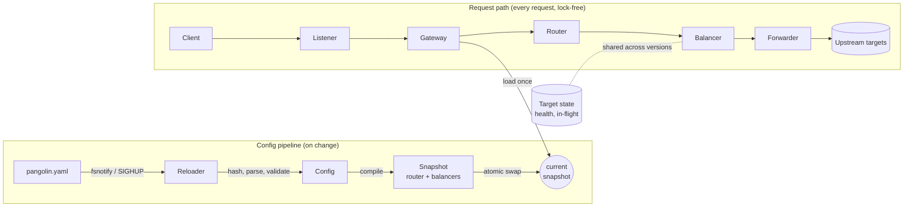
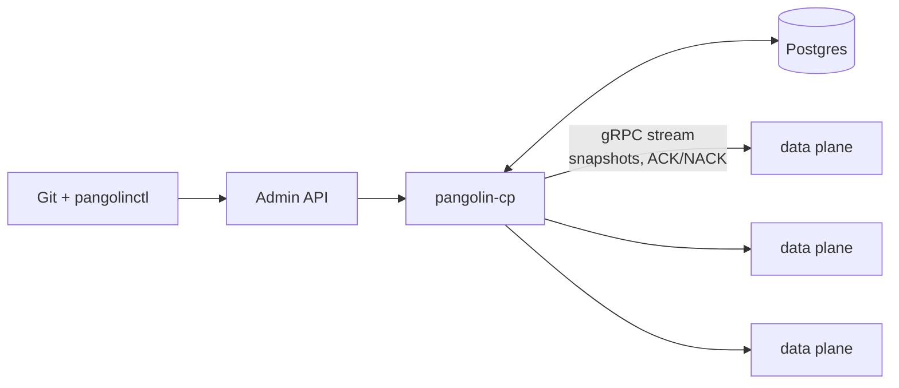

<p align="center">
  
</p>

<h1 align="center">Pangolin</h1>

<p align="center">
  <strong>A fast, Kubernetes-native API gateway in a single Go binary.</strong><br>
  Declarative config, atomic hot reloads, strict validation, and zero runtime dependencies.
</p>

<p align="center">
  <a href="https://github.com/hyphen-ani/pangolin/actions/workflows/ci.yml"></a>
  <a href="https://goreportcard.com/report/github.com/hyphen-ani/pangolin"></a>
  <a href="https://pkg.go.dev/github.com/hyphen-ani/pangolin"></a>
  
  <a href="LICENSE"></a>
  
  <a href="CONTRIBUTING.md"></a>
</p>

---

> **Status: pre-alpha.** Pangolin is under active development and not yet ready for production traffic. The config schema (`pangolin.dev/v1alpha1`) may change between releases. See the [roadmap](#roadmap) for what works today.

## Table of contents

- [Why Pangolin](#why-pangolin)
- [Features](#features)
- [Pangolin and Kong](#pangolin-and-kong)
- [Quick start](#quick-start)
- [Configuration](#configuration)
- [Routing rules](#routing-rules)
- [Load balancing](#load-balancing)
- [Hot reload](#hot-reload)
- [CLI reference](#cli-reference)
- [Architecture](#architecture)
- [Project layout](#project-layout)
- [Development](#development)
- [Roadmap](#roadmap)
- [Contributing](#contributing)
- [License](#license)

## Why Pangolin

API gateways sit in front of everything, so they should be the most predictable part of your stack. Pangolin is built around a few strong opinions:

- **One static binary.** No Nginx, no Lua runtime, no sidecar processes. Download it, point it at a YAML file, and run it. The container image is distroless.
- **Configuration is data, and it is checked strictly.** Unknown keys, unanchored regexes, conflicting routes and invalid targets are rejected at load time with field-level errors, all reported in one pass. Nothing is silently ignored.
- **Reloads are atomic.** Every config version compiles into an immutable snapshot that goes live with a single atomic pointer swap. In-flight requests finish on the version they started with, and a bad config never replaces a good one.
- **The core knows nothing about your product.** Teams adopt Pangolin by writing config, never by forking it. Extension points use open standards: Kubernetes Gateway API, OpenTelemetry, Prometheus, proxy-wasm and Envoy ext-authz.
- **Fully open source.** Apache-2.0, end to end. There is no enterprise edition and no features held back.

## Features

**Available now**

- Hand-written HTTP reverse proxy: streamed bodies, hop-by-hop header handling, `X-Forwarded-*`, trailers, pooled keep-alive upstream connections
- Routing by host (exact and `*.wildcard`), path (exact, segment-aware prefix, RE2 regex), method and headers, with deterministic precedence
- `strip_path`, service base paths and `preserve_host`
- Load balancing: smooth weighted round-robin and weighted least-connections, with drained targets (`weight: 0`)
- Strict YAML config with schema versioning and all-errors-at-once validation
- Route conflict detection at load time
- Hot reload on file change or `SIGHUP`, with content hashing, debouncing, and zero dropped requests
- Target health and in-flight state preserved across reloads
- Graceful shutdown that drains in-flight requests
- `pangolin validate` for CI pipelines

**Coming in v0.1**

- Active and passive health checks with automatic ejection
- Per-route timeouts, retries with retry budgets, and body size limits
- TLS termination with SNI, HTTP/2, and HTTP→HTTPS redirects
- Request IDs, structured access logs, Prometheus metrics, OpenTelemetry tracing
- Admin listener and a `pangolin.conf` node configuration file
- Docker image, Helm chart, Grafana dashboard and benchmark harness

See the [roadmap](#roadmap) for later phases, including auth, rate limiting, the control plane, the Gateway API controller and WASM plugins.

## Pangolin and Kong

[Kong](https://github.com/Kong/kong) is a mature, widely deployed gateway, and much of Pangolin's design is inspired by it. Pangolin makes different trade-offs.

| | Pangolin | Kong |
| --- | --- | --- |
| **Runtime** | Single static Go binary | OpenResty (Nginx + LuaJIT) |
| **Runtime dependencies** | None in file mode | Bundled Nginx/OpenResty; Postgres in DB mode, or DB-less declarative mode |
| **Reload model** | Immutable snapshot, one atomic pointer swap; request path is lock-free | Config propagated into Nginx worker processes |
| **Config validation** | Strict: unknown keys, unanchored regexes and route conflicts fail the load | Schema-validated entities |
| **Path prefixes** | Segment-aware by default (`/users` never matches `/usersettings`) | String prefix matching |
| **Built-in plugins** | Go, compiled in (auth, rate limits and more from v0.2) | Large Lua plugin library |
| **Custom extensions** | proxy-wasm and gRPC ext-authz (planned, v1.0) | Lua plugins, external plugin servers, WASM filters |
| **Kubernetes** | Gateway API controller (planned, v0.5) | Kong Ingress Controller with Gateway API support |
| **License** | Apache-2.0, everything included | Open-source core plus commercial Enterprise features |
| **Maturity** | Pre-alpha | Production-proven at very large scale |

**Where Pangolin is different by design**

- **No second language or runtime to operate.** Your team debugs one Go process with standard tools (`pprof`, the race detector, Delve), not Nginx internals plus Lua.
- **Safer by default.** Regex routes must be anchored, prefix matches respect path segments, and two routes that could shadow each other are rejected before they reach traffic.
- **Reloads you can reason about.** A request sees exactly one config version from start to finish, and the hot path never takes a lock.
- **Open standards over a plugin dialect.** Extensions will target proxy-wasm and Envoy's ext-authz protocol, so they are portable across gateways.

**Where Kong is ahead today**

Kong has years of production hardening, a very large plugin ecosystem, a developer portal, a commercial support offering, and a big community. If you need those now, use Kong. Pangolin aims to be the simpler, fully open alternative as it matures.

## Quick start

**Requirements:** Go 1.24 or newer.

```bash
git clone https://github.com/hyphen-ani/pangolin.git
cd pangolin
make build          # produces ./bin/pangolin
```

Start two sample upstreams, each in its own terminal:

```bash
make echo           # echo-a on :9000
make echo2          # echo-b on :9001
```

Run the gateway with the example config:

```bash
./bin/pangolin run --config examples/pangolin.yaml
```

Send some traffic:

```bash
curl -s localhost:8080/users/abc | jq
for i in $(seq 30); do curl -s localhost:8080/users/abc | jq -r .server; done | sort | uniq -c
#   20 echo-a
#   10 echo-b
```

## Configuration

Pangolin reads one YAML document. All fields are listed below; anything not listed is an error.

```yaml
apiVersion: pangolin.dev/v1alpha1     # required
kind: Config                          # required
services:
  - name: orders-api                  # required; lowercase, digits, '-'; unique
    path: /api                        # optional base path prepended upstream
    upstream:
      scheme: http                    # http (default) | https
      algorithm: round-robin          # round-robin (default) | least-connections
      targets:                        # at least one; at least one with weight > 0
        - host: 10.0.0.11
          port: 8080
          weight: 100                 # 0-1000, default 100; 0 = drained
        - host: 10.0.0.12
          port: 8080
          weight: 50
    routes:                           # at least one
      - name: orders                  # required; unique across the whole config
        hosts: [api.example.com, "*.example.com"]
        paths: [/v1/orders, "=/healthz", "~^/v1/orders/[0-9]+$"]
        methods: [GET, POST]
        headers:
          X-Api-Version: [v2]         # request must carry one of the values
        priority: 0                   # 0-1000, tie-breaker for regex routes
        strip_path: true              # default true
        preserve_host: false          # default false
```

### Path syntax

| Written as | Kind | Matches |
| --- | --- | --- |
| `/users` | Prefix | `/users`, `/users/42`, `/users/42/orders`; **not** `/usersettings` |
| `=/healthz` | Exact | Only `/healthz` |
| `~^/users/[0-9]+$` | Regex (RE2) | Must start with `^/` |

Always quote regex and exact paths. A bare `~` means `null` in YAML.

### Field reference

| Field | Type | Default | Notes |
| --- | --- | --- | --- |
| `services[].name` | string | — | DNS-label style, unique |
| `services[].path` | string | `""` | Must start with `/` |
| `upstream.scheme` | string | `http` | `http` or `https` |
| `upstream.algorithm` | string | `round-robin` | or `least-connections` |
| `targets[].host` | string | — | Hostname or IP, no scheme |
| `targets[].port` | int | — | 1–65535 |
| `targets[].weight` | int | `100` | 0–1000; `0` drains the target |
| `routes[].name` | string | — | Unique across all services |
| `routes[].hosts` | []string | any host | Lowercased; single leading `*.` wildcard allowed; no ports |
| `routes[].paths` | []string | `/` | See [Path syntax](#path-syntax) |
| `routes[].methods` | []string | any method | Upper-cased automatically |
| `routes[].headers` | map | none | Header names are canonicalised |
| `routes[].priority` | int | `0` | Higher wins among regex routes |
| `routes[].strip_path` | bool | `true` | Removes the matched prefix before forwarding |
| `routes[].preserve_host` | bool | `false` | Forward the client's `Host` header |

A route needs at least one of `hosts` or `paths`.

### Path rewriting

With `path: /api` on the service and `strip_path: true` on a route matching `/users`:

| Client requests | Upstream receives |
| --- | --- |
| `/users/42` | `/api/42` |
| `/users` | `/api` |
| `/users?id=7` | `/api?id=7` |

Regex routes are never stripped.

## Routing rules

Pangolin resolves every request with the same deterministic order:

1. **Host, most specific first:** exact host, then wildcard hosts (longest suffix first), then routes with no `hosts`. If a host's table has no matching path, the next table is tried. A route bound to a host therefore beats a host-less route, even a regex one.
2. **Path, within a host:** exact, then regex (by `priority`, then specificity, then config order), then the longest matching prefix.
3. **Same path in several routes:** the route with more criteria wins. Each header counts 2 and a method list counts 1; config order breaks remaining ties.
4. **Criteria are AND, values are OR:** all of a route's `hosts`, `paths`, `methods` and `headers` must match, and any one value within each list is enough.

Host matching ignores the port and letter case, so `API.Example.com:8443` matches `api.example.com`. A wildcard `*.example.com` matches `a.example.com` and `a.b.example.com`, but not `example.com`.

Two routes with identical hosts, paths, methods, headers and priority are a **load-time error**, because one of them could never match.

### Errors generated by Pangolin

| Status | When |
| --- | --- |
| `404` | No route matched |
| `502` | Upstream refused or reset the connection |
| `503` | No healthy targets, or no config loaded yet |
| `504` | Upstream timed out |
| `499` | Client disconnected before the upstream answered (logged only) |

Error bodies are JSON: `{"message": "no route matched"}`.

## Load balancing

| Algorithm | Behaviour |
| --- | --- |
| `round-robin` | Smooth weighted round-robin (the algorithm nginx uses). Weights 5:1:1 produce `a a b a c a a`: exact proportions, without bursts. |
| `least-connections` | Picks the lowest in-flight-requests-to-weight ratio. Ties rotate, so idle pools spread evenly. Lock-free. |

Targets with `weight: 0` are drained and receive no new requests. Health and in-flight counts belong to the target's address, not to a config version, so they survive reloads.

## Hot reload

Pangolin watches the config file's directory and reloads when:

- the file changes (debounced by 250 ms, so editor saves and Kubernetes ConfigMap symlink swaps work), or
- the process receives `SIGHUP`.

Each reload:

1. Reads the file and hashes it. An unchanged hash is a no-op.
2. Decodes it strictly and validates it.
3. Compiles a new snapshot (router and balancers), reusing target runtime state.
4. Swaps it in atomically.

If any step fails, the error is logged and **the current config keeps serving**. Settings that can't change at runtime, such as listen addresses and the drain timeout, are command-line flags, and from v0.1 they live in `pangolin.conf`.

## CLI reference

```
pangolin <command> [flags]

Commands:
  run        start the gateway
  validate   check a config file and exit (non-zero on errors)
```

**`pangolin run`**

| Flag | Default | Description |
| --- | --- | --- |
| `--config` | `pangolin.yaml` | Path to the config file |
| `--listen` | `:8080` | Proxy listen address |
| `--drain-timeout` | `30s` | Maximum time to finish in-flight requests on shutdown |
| `--log-level` | `info` | `debug`, `info`, `warn` or `error` |

**`pangolin validate`**

| Flag | Default | Description |
| --- | --- | --- |
| `--config` | `pangolin.yaml` | Path to the config file |

`validate` runs the same pipeline as a reload, including route conflict detection, and exits with status `1` on any error. That makes it suitable as a CI gate.

## Architecture

Pangolin separates **what the config says** from **what the gateway is doing right now**.



### Request lifecycle

1. **Accept.** The listener enforces header size limits and slowloris timeouts.
2. **Snapshot.** The gateway loads the current snapshot once. The request uses that config version from start to finish.
3. **Route.** The router picks a route by host, path, method and headers, using structures compiled ahead of time: a host map, a segment trie for prefixes, and pre-sorted regex lists.
4. **Balance.** The service's balancer picks a healthy target, and the target's in-flight count is incremented.
5. **Forward.** The forwarder rewrites the URL (strip path, base path, Host), removes hop-by-hop headers, sets `X-Forwarded-*`, and streams the request and response through pooled upstream connections.
6. **Release.** The in-flight count drops even if the response is aborted mid-stream.

### Design principles

- **Immutable snapshots.** Everything derived from config is built once and never mutated. Writers take a lock; readers never do.
- **Fail closed at load, never at request time.** Expensive checks (regex compilation, conflict detection) happen while building the snapshot.
- **Streaming everywhere.** Bodies are never fully buffered by the core.
- **Pluggable backends.** Config stores, rate-limit stores, identity providers and secret sources sit behind Go interfaces.

### Planned control plane (v0.4)



Data planes never call the control plane on the request path. If the control plane is down, they keep serving their last known good snapshot.

## Project layout

```
pangolin/
├── cmd/pangolin/        # CLI entrypoint: run, validate
├── internal/
│   ├── config/          # schema types, strict loading, defaults, validation
│   ├── router/          # compiled routing: host tables, segment trie, regex
│   ├── balancer/        # targets, shared state, round-robin, least-connections
│   ├── gateway/         # snapshots, atomic apply, top-level handler
│   ├── proxy/           # forwarder, transport, header handling
│   ├── reload/          # file watcher, SIGHUP, content hashing
│   └── server/          # listener and graceful shutdown
├── examples/            # sample configs
├── hack/echo/           # test upstream that echoes requests as JSON
└── asset/               # logo and images
```

## Development

```bash
make build       # build ./bin/pangolin
make test        # go test -race ./...
make validate    # validate examples/pangolin.yaml
make run         # run with the example config and debug logging
make echo        # start echo-a on :9000
make echo2       # start echo-b on :9001
```

The echo server reflects each request back as JSON and supports `?status=503` and `?delay=2s` for simulating failures and slow upstreams.

Every package has table-driven tests, and the suite always runs with the race detector. Reload behaviour is covered by a test that applies 100 config versions under concurrent load and asserts that zero requests fail.

## Roadmap

Each phase is a complete, tested release that is useful on its own.

**Phase 1: v0.1 Core proxy**
- [x] Reverse proxy core with graceful shutdown
- [x] Strict config schema and validation
- [x] Router: hosts, exact, prefix and regex paths, methods, headers
- [x] Load balancing: smooth weighted round-robin, least-connections
- [x] Immutable snapshots and atomic hot reload
- [ ] Active and passive health checks
- [ ] Timeouts, retries with budgets, body limits
- [ ] TLS termination, SNI, HTTP/2
- [ ] Request IDs, access logs, Prometheus, OpenTelemetry
- [ ] Admin listener and `pangolin.conf`
- [ ] Docker image, Helm chart, benchmarks

**Phase 2: v0.2 Edge security.** API keys, JWT (JWKS), basic auth, consumers, ACLs, CORS, header and path transforms, trusted proxies.

**Phase 3: v0.3 Traffic control.** Rate limiting (local and Redis), response caching, circuit breaking, maintenance mode.

**Phase 4: v0.4 Control plane.** `pangolin-cp` with Postgres, Admin API, gRPC config streaming, workspaces, `pangolinctl`.

**Phase 5: v0.5 Protocols and Kubernetes.** WebSockets, gRPC, SSE, and the Gateway API controller.

**Phase 6: v1.0 Extensibility.** proxy-wasm and ext-authz plugins, OIDC, upstream mTLS, and a stable `v1` config schema.

## Contributing

Contributions are welcome. Pangolin is early, so the most valuable things right now are bug reports, test cases for routing edge cases, and feedback on the config format.

1. Open an issue to discuss larger changes before writing code.
2. Keep pull requests focused, with tests. `make test` must pass with the race detector.
3. Run `go vet ./...` and `gofmt` before pushing.

## License

Pangolin is licensed under the [Apache License, Version 2.0](LICENSE).

```
Copyright 2026 The Pangolin Authors

Licensed under the Apache License, Version 2.0 (the "License");
you may not use this file except in compliance with the License.
You may obtain a copy of the License at

    http://www.apache.org/licenses/LICENSE-2.0

Unless required by applicable law or agreed to in writing, software
distributed under the License is distributed on an "AS IS" BASIS,
WITHOUT WARRANTIES OR CONDITIONS OF ANY KIND, either express or implied.
See the License for the specific language governing permissions and
limitations under the License.
```